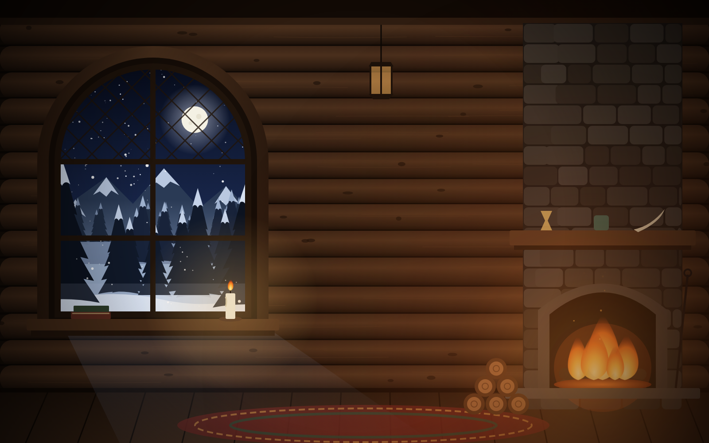

# Winter cabin

A Claude Code look for the desktop and mobile apps. You sit inside a log cabin deep in a snowbound
fantasy forest at night: snow drifts past a tall arched window onto moonlit pines and far peaks, a
candle burns on the sill, and a fire crackles in the stone hearth, its glow flickering across the
timber walls. The colors follow it: smoky timber surfaces, ember accents, pine greens and moonlit
frost. Dark mode only. The terminal draws no looks.

The scene is one animated SVG in `hooks/scene.ts`; it honours reduced-motion settings.



## Install

Copy this folder somewhere on your machine and start Claude Code with it as a plugin folder:

```bash
claude --plugin-dir ./winter-cabin-theme
```

Then open the session in the Claude desktop or mobile app to see the look.

## Rebuild the scene

`tools/gen_scene.py` draws the SVG (trees, snow and stones are placed from a fixed seed):

```bash
python3 tools/gen_scene.py /tmp/scene.svg hooks/scene.ts
```
